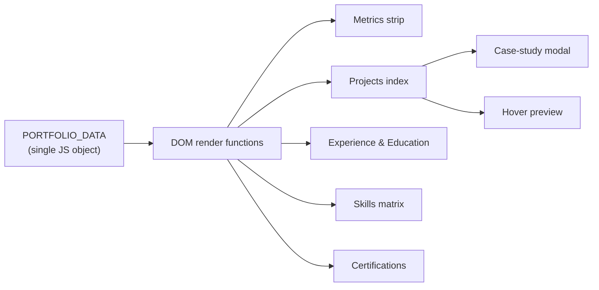

# Edrick I. Brittoe

Data Analyst with an MBA in AI & Data Science (SRM IST, 9.1 CGPA). I build Power BI dashboards and use SQL and Python to turn raw data into decisions.

[Projects](#projects) · [Experience](#experience) · [Skills](#skills) · [How it works](#how-it-works) · [Contact](#contact)

This repo is the source of my portfolio: **[edrickbrittoe.github.io/Edrick-I-Brittoe](https://edrickbrittoe.github.io/Edrick-I-Brittoe/)**

## Projects

<b>Public Perception of AI in Advertising</b> (2025)

 

Capstone research on how consumers view AI-generated ads. 130+ survey respondents, 25+ variables.

- Cleaned and analysed the data in Python (Pandas, SciPy, Statsmodels) and Excel
- Used correlation, regression, Chi-Square and ANOVA to compare trust, purchase intent and perceived authenticity across groups
- Built 5+ Power BI dashboards with 40+ visuals

`Python` `Power BI` `Excel` `ANOVA` `Chi-Square`

<b>Resume–Job Description Matching Tool</b> (2024)

 

Scores how well a resume fits a job description using NLP.

- Cosine similarity with scikit-learn's CountVectorizer
- PDF/DOCX parser with 95%+ extraction accuracy
- Score breakdown showing keyword overlap and missing skills

`Python` `scikit-learn` `NLP`

<b>IPL Data Analysis Dashboard</b> (2025)

 

Power BI dashboard covering 500+ matches and 100+ player metrics over 5 seasons.

- Modeled 50,000+ records with Excel and Power Query
- Custom DAX for strike rate, bowling economy and match impact
- Drill-downs for head-to-head records, venues and player milestones

`Power BI` `DAX` `Power Query` `Excel`

## Experience

<b>Data Analytics Intern, Labmentix</b> (Jun – Sep 2025)

 

- Cleaned and validated 15+ business datasets with Excel, SQL and Python
- Built 8+ Power BI dashboards that improved reporting accuracy by 30%
- Cut data processing time by 25% using Power Query and Excel automation

## Skills

| | |
|---|---|
| **BI & analysis** | Power BI, DAX, Power Query, advanced Excel, EDA, KPI reporting |
| **Programming** | Python (Pandas, NumPy, Matplotlib, Seaborn, scikit-learn), SQL (MySQL) |
| **Stats & ML** | Regression, ANOVA, Chi-Square, NLP |

## Education

- **MBA, AI & Data Science**, SRM Institute of Science and Technology (2024–2026), CGPA 9.1
- **B.Com**, SA College of Arts & Science (2021–2024)

## Certifications

- Google AI Professional Certificate ([verify](https://coursera.org/verify/professional-cert/IZOW4LIVNI3M))
- Power BI for Beginners, Simplilearn SkillUp
- Effective Leadership, HP LIFE

## How it works

The site is a single `index.html`. All content sits in one `PORTFOLIO_DATA` object and the page renders itself from it, so updating the site means editing that object.

Built with HTML, Tailwind CSS (CDN) and vanilla JavaScript.

## Contact

Open to data analyst roles. Reach me at [edrickbrittoe@gmail.com](mailto:edrickbrittoe@gmail.com) or on [LinkedIn](https://www.linkedin.com/in/edrick-brittoe-54687228a).
