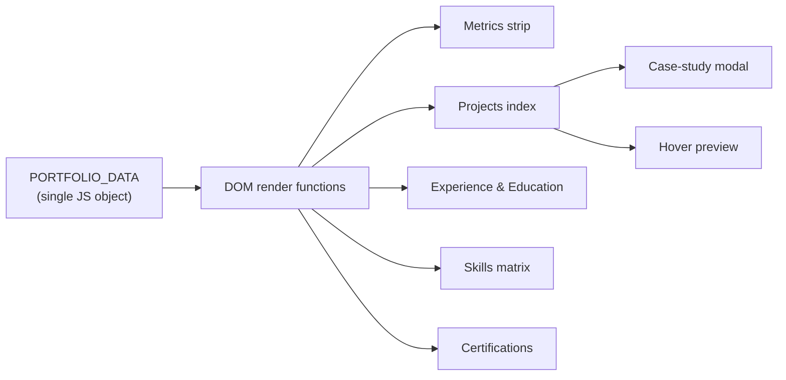

<!-- ======================= HEADER ======================= -->
<div align="center">


<a href="https://github.com/Edrickbrittoe/YOUR-REPO-NAME">
  
</a>

<br/>

[](https://YOUR-LIVE-URL-HERE)
[](https://www.linkedin.com/in/edrick-brittoe-54687228a)
[](mailto:edrickbrittoe@gmail.com)
[](https://github.com/Edrickbrittoe)


</div>

---

## 🧭 Quick Navigation

<div align="center">

| [**👤 About**](#-about-this-portfolio) | [**📊 Metrics**](#-at-a-glance) | [**🗂 Projects**](#-selected-works) | [**💼 Experience**](#-experience) | [**🛠 Skills**](#-technical-arsenal) |
|:---:|:---:|:---:|:---:|:---:|
| [**🎓 Education**](#-education) | [**🏅 Certifications**](#-certifications) | [**✨ Features**](#-site-features) | [**⚙️ Run & Customize**](#%EF%B8%8F-run-it-locally) | [**📬 Contact**](#-contact) |

</div>

---

## 👤 About This Portfolio

This is the source code of my personal portfolio, a single-page site in an **editorial Swiss design** style that presents my work as a Data Analyst.

> *"Data Analyst translating complex numbers into strategic business clarity."*

I completed my **MBA in Artificial Intelligence & Data Science (9.1 CGPA)** at SRM IST and work with **Power BI, SQL, Python, and predictive analytics** to build decision-grade dashboards and find high-impact growth levers.

🌐 **Live site:** [YOUR-LIVE-URL-HERE](https://YOUR-LIVE-URL-HERE)

---

## 📊 At a Glance

<div align="center">

| 🗃 **50,000+** | 📈 **8+** | 🎯 **30%** | 🎓 **9.1** |
|:---:|:---:|:---:|:---:|
| Records modeled | Dashboards deployed | Reporting accuracy gain | MBA CGPA |
| Cleaned & transformed with Excel, Power Query & SQL | Interactive Power BI reports for cross-functional teams | Plus a 25% cut in data processing cycles | AI & Data Science, SRM IST |

</div>

---

## 🗂 Selected Works

> Click a project to expand its case study.

<details>
<summary><b>01 · Public Perception of AI in Advertising</b> &nbsp;·&nbsp; <i>Behavioral Analytics & Market Research · 2025</i></summary>

<br/>

**Category:** Statistical Research / Capstone  
**Period:** June 2025 – September 2025  
**Scope:** 130+ respondents · 25+ variables · 5+ dashboards · 40+ visuals


An end-to-end analytics and market research project on how consumers perceive AI-generated advertising.

- Cleaned, preprocessed, and explored survey data and ran statistical models with Python (Pandas, SciPy, Statsmodels) and Excel.
- Measured consumer awareness, trust, purchase intent, acceptance, and perceived authenticity across demographic cohorts.
- Applied correlation analysis, linear and logistic regression, Chi-Square tests of independence, and one-way ANOVA across 25+ psychometric variables.
- Built 5+ interactive Power BI dashboards with 40+ visualizations that surfaced 12+ consumer behavior patterns and marketing recommendations.

</details>

<details>
<summary><b>02 · Resume–Job Description Matching Tool</b> &nbsp;·&nbsp; <i>NLP & Machine Learning · 2024</i></summary>

<br/>

**Category:** Machine Learning / NLP  
**Period:** December 2024  
**Scope:** 95%+ parsing accuracy · automated scoring · multi-format parser


An automated system that scores how well a resume fits a job description.

- Paired **cosine similarity** with scikit-learn's **CountVectorizer** to turn unstructured text into vectors.
- Built a PDF/DOCX parsing pipeline with regex cleanup, tokenization, and stopword filtering, reaching 95%+ extraction accuracy.
- Designed a match score breakdown showing keyword overlap, missing technical skills, and semantic relevance rankings.
- Benchmarked against sample datasets to keep scoring consistent.

</details>

<details>
<summary><b>03 · IPL Data Analysis Dashboard</b> &nbsp;·&nbsp; <i>Sports Analytics & Performance BI · 2025</i></summary>

<br/>

**Category:** Business Intelligence  
**Period:** August 2025  
**Scope:** 500+ matches · 100+ player metrics · 50,000+ records


An interactive Power BI dashboard covering 500+ IPL cricket matches and 100+ player performance metrics across 5 seasons.

- Collected, cleaned, and modeled 50,000+ raw records with Excel and Power Query.
- Wrote custom DAX measures for strike-rate variations, powerplay vs. death-over bowling economy, and match-impact indices.
- Built KPI-driven views with 20+ dynamic metrics for real-time decision-making.
- Added cross-filtering drill-downs for team head-to-head records, venue trends, and player milestone forecasts.

</details>

---

## 💼 Experience

<details open>
<summary><b>Data Analytics Intern</b> @ <b>Labmentix</b> &nbsp;·&nbsp; <i>June 2025 – September 2025 · Chennai, India</i></summary>

<br/>

- Collected, cleaned, validated, and transformed 15+ business datasets using Excel, SQL, and Python.
- Built 8+ interactive Power BI dashboards and executive reports that improved reporting accuracy by **30%** across teams.
- Used Power Query (M) and Excel automation to cut regular data processing cycles by **25%**.
- Ran trend analysis and turned KPI monitoring and variance forecasting into business insights.
- Worked with senior analytics teams on business reporting, statistical interpretation, and dashboard modernization.

`Power BI` `SQL (MySQL)` `Python` `Excel` `Power Query` `DAX` `KPI Monitoring`

</details>

---

## 🛠 Technical Arsenal

<table>
<tr>
<td width="50%" valign="top">

**📈 Data Analysis & BI**
<br/>Core analytical rigor and enterprise reporting
- Data cleaning & validation
- Exploratory Data Analysis (EDA)
- Trend analysis & forecasting
- KPI systems
- Business analytics
- Dashboard architecture

</td>
<td width="50%" valign="top">

**🎨 BI & Visualization Tools**
<br/>Interactive visual intelligence and modeling
- Power BI
- DAX
- Power Query (ETL)
- Microsoft Excel (advanced)
- Pivot tables & lookups
- Executive visual storytelling

</td>
</tr>
<tr>
<td width="50%" valign="top">

**🐍 Programming & Databases**
<br/>Scripting, querying, and model building
- Python
- Pandas & NumPy
- Matplotlib & Seaborn
- scikit-learn
- SQL (MySQL queries & joins)
- Data pipeline transformation

</td>
<td width="50%" valign="top">

**🤖 AI & Modern Tools**
<br/>Cognitive technologies and workflow automation
- Microsoft Copilot
- Prompt engineering
- Generative AI workflows
- Natural Language Processing (NLP)
- Statistical hypothesis testing (ANOVA, Chi-Square)
- Regression modeling

</td>
</tr>
</table>

<div align="center">


</div>

---

## 🎓 Education

| Degree | Institution | Period | Grade |
|---|---|---|---|
| **MBA in Artificial Intelligence & Data Science** | SRM Institute of Science and Technology | 2024 – 2026 | CGPA 9.1 |
| **Bachelor of Commerce (B.Com)** | SA College of Arts & Science | 2021 – 2024 | Aggregate 69% |

<sub>MBA focus: Business Analytics, Machine Learning, Predictive Modeling & Decision Sciences. B.Com foundation: Financial Analysis, Quantitative Accounting & Statistics.</sub>

---

## 🏅 Certifications

| Certification | Issuer | Focus |
|---|---|---|
| **Power BI for Beginners** | Simplilearn SkillUp | Data preparation, dimensional modeling, DAX, report design, and service deployment |
| **Google AI Professional Certificate** | Google · [Verify on Coursera](https://coursera.org/verify/professional-cert/IZOW4LIVNI3M) | 8-course specialization: AI fundamentals, prompt engineering, AI for data analysis, rapid prototyping, workplace solutions |
| **Effective Leadership** | HP LIFE | Cross-functional team leadership, ethical decision-making, strategic execution |

---

## ✨ Site Features

The portfolio is a **single `index.html`** with no framework and no build step.

| | Feature | Details |
|---|---|---|
| 🌗 | **Dark / light theme** | Follows the system preference, remembers your choice, and has no flash on load |
| 🌊 | **Animated data-wave background** | Canvas-drawn lines that react to scrolling and adapt to the active theme |
| 🕒 | **Live Chennai clock** | Shows IST time next to an "Open to Roles" status |
| 🖱 | **Hover previews** | Hovering a project row shows an inline preview graphic |
| 🔍 | **Case-study modals** | Click a project to open its full write-up (close with `ESC`) |
| 🔢 | **Animated metric counters** | Headline numbers count up as they scroll into view |
| 🧭 | **Scroll-spy navigation + progress bar** | The active section is highlighted as you scroll |
| 📄 | **In-page resume viewer** | Read the resume in a modal or download it as a PDF |
| 📋 | **One-click email copy** | Copies my address to the clipboard |
| ✉️ | **Contact form without a backend** | Opens Gmail with the message pre-filled |
| ♿ | **Reduced-motion support** | Respects `prefers-reduced-motion` |

---

## 🧩 How It Works

All content lives in one JavaScript object, `PORTFOLIO_DATA`, and the page renders itself from it.



**Stack:** HTML5 · [Tailwind CSS](https://tailwindcss.com/) (CDN) · Vanilla JavaScript · Canvas API · Google Fonts (*Inter* and *JetBrains Mono*)

---

## ⚙️ Run It Locally

```bash
# 1. Clone the repo
git clone https://github.com/Edrickbrittoe/YOUR-REPO-NAME.git
cd YOUR-REPO-NAME

# 2. Open it directly...
open index.html          # macOS
# start index.html       # Windows
# xdg-open index.html    # Linux

# ...or serve it locally
python3 -m http.server 8000
# then visit http://localhost:8000
```

> **Note:** Tailwind and Google Fonts load from CDNs, so you need an internet connection to see the full styling.

### ✏️ Customize It

Open `index.html` and edit the `PORTFOLIO_DATA` object. Each section has its own block:

| Section | Key in `PORTFOLIO_DATA` |
|---|---|
| Name, headline, summary, links | `personal` |
| Headline numbers | `metrics` |
| Project case studies | `projects` |
| Work history | `experience` |
| Degrees | `education` |
| Skill groups | `skills` |
| Certificates | `certifications` |
| Contact details | `contact` |

### 🚀 Deploy to GitHub Pages

1. Push this repo to GitHub.
2. Go to **Settings → Pages**.
3. Under **Build and deployment**, choose **Deploy from a branch**, then select `main` and `/ (root)`.
4. Save. Your site goes live at `https://<username>.github.io/<repo-name>/`.

---

## 📈 GitHub Stats

<div align="center">


</div>

---

## 📬 Contact

Got a dataset, a role, or an idea? Let's turn it into better decisions.

<div align="center">

[](mailto:edrickbrittoe@gmail.com)
[](https://www.linkedin.com/in/edrick-brittoe-54687228a)
[](https://github.com/Edrickbrittoe)

📍 Chennai, Tamil Nadu, India · IST (UTC+5:30)

</div>

---

<div align="center">

<sub>© 2026 Edrick I. Brittoe · Built with Swiss editorial precision</sub>

<br/>

[⬆ Back to top](#)


</div>
